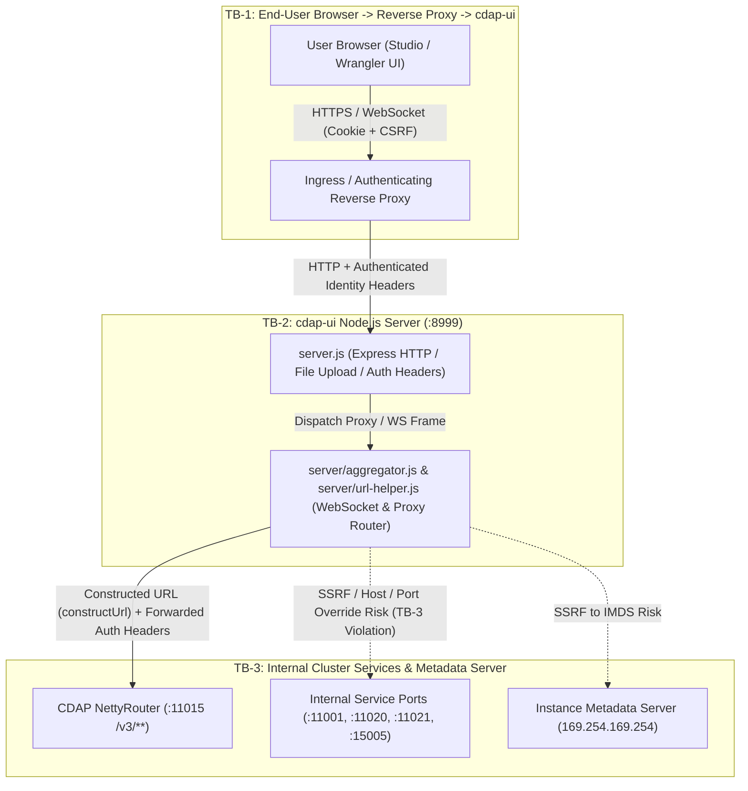

# Security Threat Model: CDAP Web UI & Node.js Backend (`cdapio/cdap-ui`)

**Scope:** `https://github.com/cdapio/cdap-ui` (branches `develop`, `release/*`)  
**Components:** Node.js Express Backend (`server.js`, `server/aggregator.js`, `server/url-helper.js`, `server/config/`) and React/TypeScript Browser Frontend (`app/`, `src/`)

---

## 1. Asset Definition & Scope

This threat model defines the trust boundaries, untrusted user-controlled inputs, runtime identities, known sink classes, and security invariants for **CDAP UI** (`cdapio/cdap-ui`), the Node.js server and React/TypeScript browser frontend that serves the CDAP Studio web interface.

- **Node.js Backend Proxy & WebSocket Aggregator (`server.js`, `server/aggregator.js`, `server/url-helper.js`, `server/config/`)**:
  - Listens on port `:8999` (or `:11011`), receiving browser HTTP and WebSocket (`socket.io` / `ws`) requests.
  - Proxies UI API requests (`POST /backendstatus`, WebSocket `request` frames in `server/aggregator.js`, file upload streaming, market/hub proxy routes, and GraphQL queries) to the CDAP Router (`:11015`) or configured Hub endpoints using `server/url-helper.js` (`constructUrl`).
- **Browser Frontend & Client Applications (`app/`, `src/`)**:
  - Serves the single-page web applications for Pipeline Studio, Wrangler Data Prep, Replication, Metadata/Lineage, Namespace Administration, and Compute Profile management.

### Related Component Threat Models

- **CDAP Core Runtime (`cdapio/cdap`)**: `cdap/THREAT_MODEL.md`
- **CDAP Build & Packaging (`cdapio/cdap-build`)**: `cdap-build/THREAT_MODEL.md`
- **CDAP Kubernetes Operator (`cdapio/cdap-operator`)**: `cdap-operator/THREAT_MODEL.md`
- **Wrangler Data Prep Service & Directives (`data-integrations/wrangler`)**: `wrangler/THREAT_MODEL.md`
- **Hydrator Core & Database Plugins (`cdapio/hydrator-plugins`)**: `hydrator-plugins/THREAT_MODEL.md`

---

## 2. Trust Boundaries & Runtime Identities

### 2.1 Trust Boundaries

- **TB-1 (Browser Client -> `cdap-ui` Express Boundary)**:
  - Low-privileged authenticated users (such as read-only viewers) can send arbitrary HTTP and WebSocket frames to `cdap-ui` (`:8999`).
  - `cdap-ui` MUST validate CSRF tokens, preserve and forward the caller's identity and `Authorization` headers on every proxied backend call, and never substitute its own ambient container credentials.
- **TB-2 (`cdap-ui` `aggregator.js` -> `NettyRouter` `:11015` URL Construction Boundary)**:
  - In `server/aggregator.js` and `server/url-helper.js` (`constructUrl`), the client supplies a relative path or resource descriptor to be fetched by the Node.js server.
  - `constructUrl` MUST strictly pin the protocol, hostname, and port to the configured `router.server.address` (`:11015`) and canonicalize the path so that `resource.url` values like `http://169.254.169.254/...`, `//cdap-app-fabric:11001/...`, `/..`, or `@attacker.com` cannot redirect the Node.js HTTP client to internal cluster ports or the node metadata server (`169.254.169.254`).
- **TB-3 (Pod Security & Container Isolation Boundary)**:
  - `cdap-ui` must run as a non-root user under Kubernetes Restricted Pod Security Standards (`runAsNonRoot: true`, `allowPrivilegeEscalation: false`, `capabilities.drop: ["ALL"]`) and must not expose any SSRF vector to internal cluster services or `169.254.169.254`.

---

## 3. Untrusted User-Controlled Inputs & Entry Points

| Entry Point | Files / Modules | Untrusted User-Controlled Inputs | Required Validation & Guards |
|---|---|---|---|
| **WebSocket Aggregator & Proxy Endpoints** | `server.js`, `server/aggregator.js`, `server/url-helper.js` | WebSocket JSON message fields (`resource.url`, `resource.method`, `resource.headers`, `resource.body`, `resource.json`), `/backendstatus`, file upload paths | Validate via `url-helper.js` (`constructUrl`) that the resolved URL shares the exact origin (`scheme://router_host:router_port`) of `NettyRouter` (`:11015`) or the configured Hub URL, and that the normalized path starts with `/v3/`; reject absolute URLs, `//` protocol-relative URLs, `@` userinfo, and path traversal (`..`). |
| **File & Artifact Upload Proxy** | `server.js` (upload routes forwarding to `/v3/namespaces/{ns}/artifacts/...`) | Multipart/raw binary stream, custom headers (`Artifact-Version`, `Artifact-Extends`, `Artifact-Plugins`), URL path parameters | Enforce request body size limits, validate path segments against strict alphanumeric/hyphen patterns, and forward caller auth headers to `NettyRouter`. |
| **GraphQL & Express Middleware** | `server.js`, `server/graphql/`, `server/config/parser.js` | GraphQL queries/variables, query parameters, cookies, HTTP headers | Enforce query depth/complexity bounds; never log `Authorization` headers, cookies, or Secure Store payloads in console/Express error logs. |
| **Browser DOM Rendering (Studio, Wrangler, Metadata)** | `app/`, `src/` (React components, Markdown/HTML renderers, error banners, connection forms) | Pipeline names, descriptions, Wrangler column names/sample values, plugin documentation markdown, URL query parameters | Sanitize all HTML/Markdown rendering (`DOMPurify` / React auto-escaping); avoid `dangerouslySetInnerHTML`, `eval()`, or `javascript:` URLs; mask password/secret fields in connection and macro forms. |

---

## 4. Known Sink Classes & Vulnerability Patterns in Scope

1. **Server-Side Request Forgery (SSRF) & Internal Port/Path Smuggling in `aggregator.js` / `url-helper.js`**:
   - **Sinks**: `server/url-helper.js` (`constructUrl`, `deconstructUrl`), `server/aggregator.js` (HTTP client dispatch for WebSocket frames and artifact uploads), and `server.js` proxy handlers.
   - **Mechanism**: If `constructUrl(cdapConfig, path)` concatenates `router_host:router_port` with a user-supplied `path` without strict URL parsing and origin verification, a crafted `path` (such as `@169.254.169.254/computeMetadata/v1/...`, `@cdap-app-fabric:11001/v3Internal/...`, `\169.254.169.254`, or `/../v3Internal/...`) causes the Node.js server to send requests to `169.254.169.254` or unauthenticated internal Netty ports (`:11001`, `:11020`, `:11021`, `:15005`), bypassing `NettyRouter` and `@AuthEnforce`.
2. **Authentication Header Stripping, Cross-User Session Bleed, or WebSocket CSRF**:
   - **Sinks**: `server.js` WebSocket upgrade handler, `server/aggregator.js` session/header forwarding, and Express session/cookie middleware.
   - **Mechanism**: WebSocket connections upgraded on `:8999` must validate `Origin` / CSRF headers and bind the authenticated user's identity and `Authorization` headers to the socket context without sharing mutable header maps across concurrent connections.
3. **Command Injection & Configuration Parser Sinks in Node.js (`server/config/`)**:
   - **Sinks**: `child_process.exec`, `child_process.spawn` (e.g. when reading `cdap-site.xml` or invoking helper scripts in `server/config/`), `vm.runInNewContext`, `eval()`, and `Function()`.
   - **Mechanism**: Never pass request parameters or environment-derived user inputs to shell commands or JavaScript evaluators.
4. **Path Traversal & Arbitrary File Read in Static/Asset Serving (`server.js`)**:
   - **Sinks**: `fs.readFile`, `fs.createReadStream`, `res.sendFile`, `path.join` on Express routes serving static assets, locales, or plugin resources.
   - **Mechanism**: Ensure all file paths resolved from URL parameters are confined within the static build directory via `path.resolve` prefix checks.
5. **DOM XSS, Prototype Pollution & Cleartext Secret Leakage**:
   - **Sinks**: `dangerouslySetInnerHTML`, unvalidated `href`/`src` attributes in React components (`src/`), deep object merge utilities, and Redux/GraphQL state responses returning cleartext connection credentials or logging tokens in `server/aggregator.js`.

---

## 5. Core Security Invariants

1. **Invariant UI-INV-01 (Strict Router Origin & `/v3/` Path Enforcement in `url-helper.js`)**: Every URL constructed by `server/url-helper.js` (`constructUrl`) and requested by `server/aggregator.js` MUST be parsed with the standard WHATWG `new URL()` API, verified to match the exact `protocol`, `hostname`, and `port` of the configured `NettyRouter` (`:11015`) (or explicit allowlisted Hub domain), and verified to have a canonicalized `pathname` starting with `/v3/` (blocking `/v3Internal/`, `/v1/`, `..`, `@`, and `169.254.169.254`).
2. **Invariant UI-INV-02 (End-to-End Caller Identity & CSRF Enforcement)**: Every HTTP request and WebSocket upgrade handled by `server.js` and `server/aggregator.js` MUST preserve the caller's identity and `Authorization` headers, isolate them per request/socket, and reject cross-origin WebSocket upgrades or state-changing requests lacking valid `Origin` / CSRF headers.
3. **Invariant UI-INV-03 (Zero Secret Logging & Restricted Pod Security Context)**: `cdap-ui` MUST NOT log `Authorization` headers, cookies, or Secure Store payloads to stdout/stderr, and its container deployment MUST adhere to restricted Pod Security Standards (`runAsNonRoot: true`, `allowPrivilegeEscalation: false`, `capabilities.drop: ["ALL"]`).
